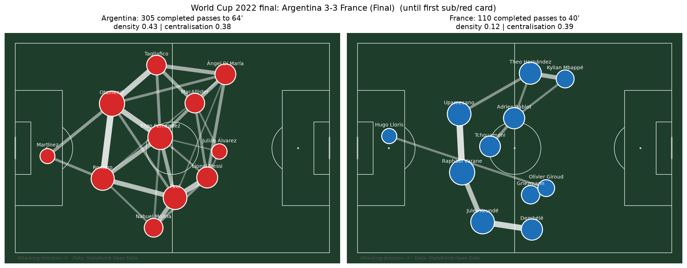
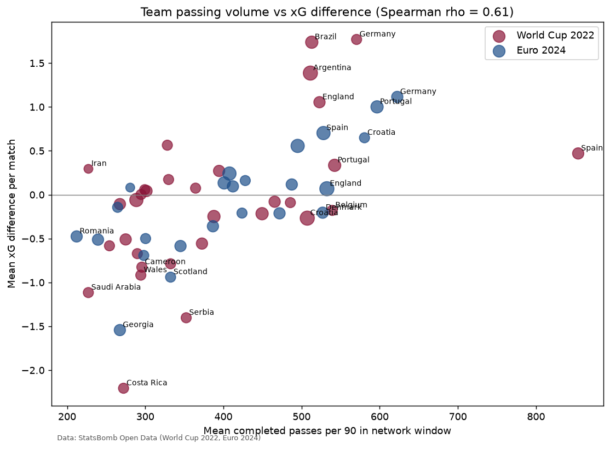
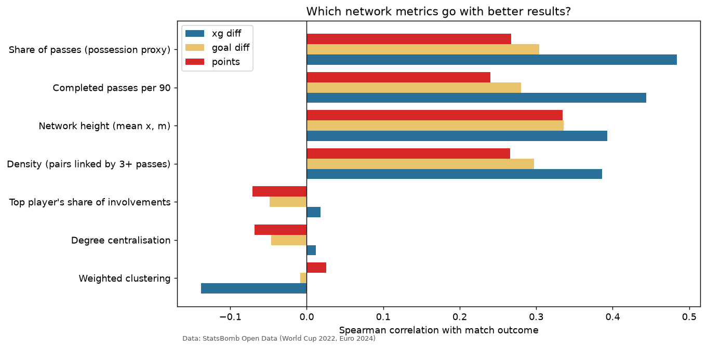
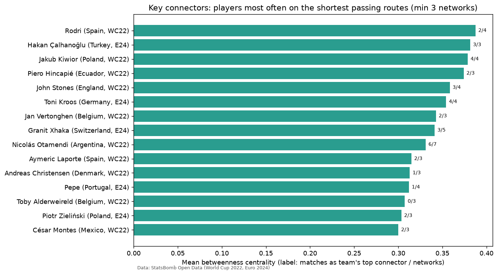
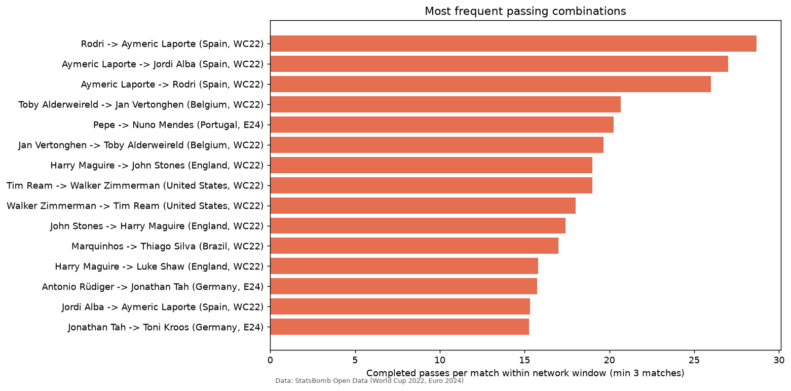
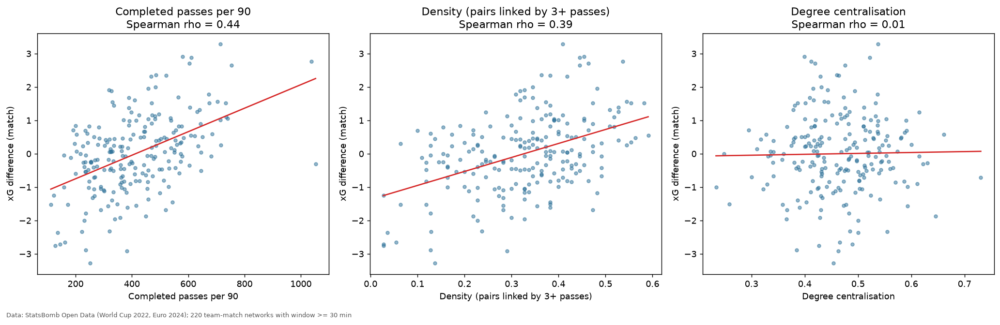
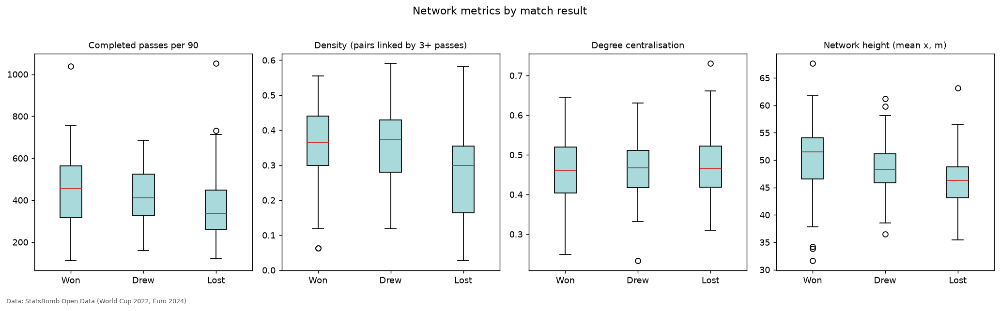
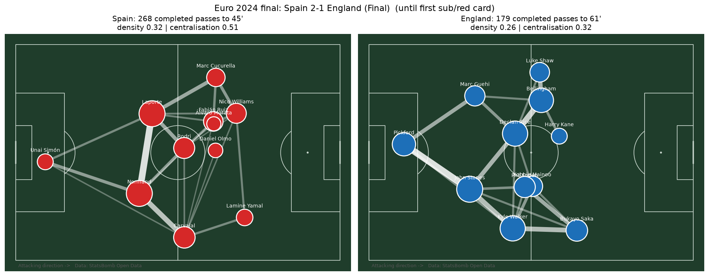

# Passing networks at the World Cup 2022 and Euro 2024

Team passing networks built from StatsBomb event data for every match of the **FIFA World Cup 2022 (64 matches)**
and **UEFA Euro 2024 (51 matches)**: average positions, pass combinations and network metrics
(density, clustering, centralisation, betweenness, eigenvector centrality), related to xG and results.
It includes an interactive Streamlit app to pick any match and team.

Author: Anthony Adusei-Poku ([@anthony07-max](https://github.com/anthony07-max))



## Key findings (230 team networks, 115 matches)

1. **Passing volume and connectedness go with better chances.** Across 220 networks with a window of at least 30 minutes,
   completed passes per 90 correlate with match xG difference at **Spearman rho = 0.44** (p < 0.001), and network density at **0.39**.
   At team level (averaged over a tournament) passes per 90 vs xG difference is **rho = 0.61**.
2. **The side that passed more won 67.9% of decided matches**, and the side with the denser network won 66.7%.
   Winners averaged **452 completed passes per 90** and a density of **0.355**. Losers averaged **365** and **0.275**.
3. **Where the network sits matters more than how big it is.** In a regression of match xG difference on the
   difference between the two sides' metrics (110 matches, standardised, robust SEs, R² = 0.40), **pass volume adds
   nothing once shape is known** (coef -0.01, p = 0.97). A higher network (+0.31 xG per SD, p = 0.03) is linked to
   better xG, and so is lower clustering (-0.37, p = 0.003) and lower centralisation (-0.24, p = 0.045). Teams that
   spread the ball through many players, rather than looping it around one hub or a closed triangle, created more.
4. **Spain at the 2022 World Cup were an outlier:** **854 completed passes per 90** and the densest network of any
   team (0.477), but their mean xG difference was only +0.47. Volume alone did not turn into dominance.
5. **Key connectors are centre-backs and holding midfielders.** The team's top-betweenness player was a centre-back
   in **46.7%** of networks (left CB 25.8%, right CB 20.9%), and a defensive midfielder in at least another 31%. The highest mean
   betweenness belongs to **Rodri** (Spain, WC 2022, 0.388), Hakan Çalhanoğlu (Turkey, Euro 2024, 0.381) and Jakub Kiwior (Poland, WC 2022, 0.379).
6. **The most-used combination was Rodri -> Laporte (28.7 completed passes per match)** for Spain at the World Cup, then
   Laporte -> Jordi Alba (27.0). Belgium's Alderweireld -> Vertonghen (20.7) was the top non-Spanish pair.
7. **Finals:** Argentina completed 305 passes before their first change (64') with a density of 0.43. France managed
   110 before their 40' double substitution (density 0.12). At Euro 2024 Spain completed 268 passes to half-time against England's 179 to 61'.

| | |
|---|---|
|  |  |
|  |  |





## Method
- **Network window:** for each team, from kick-off to its first substitution or the first red card in the match.
  This keeps the same eleven players on the pitch, which is the usual convention for passing networks. The median window is
  58.8 minutes. Networks shorter than 30 minutes (6 of 230) are shown in the app but left out of the statistics, along with their opponents.
- **Passes:** completed passes between two starting players, throw-ins excluded. A player's node is the average
  location where they made or received completed passes. Links are drawn when a pair completed 3+ passes (combined in both directions).
- **Metrics** (directed graph, weights = completed passes, using [networkx](https://networkx.org/)):
  - *Density*: the share of possible directed pairs linked by 3+ passes.
  - *Weighted clustering*: how often a player's passing partners also pass to each other.
  - *Degree centralisation*: Freeman centralisation of weighted degree (0 = evenly spread, 1 = one hub).
  - *Betweenness*: the share of shortest passing routes (distance = 1/passes) that run through a player.
  - *Eigenvector centrality*, the *top player's share* of involvements, and *network height* (involvement-weighted mean x, in metres from the team's own goal line).
- **Outcomes:** StatsBomb xG for and against over the whole match (penalty shoot-outs excluded), goals and points. Knockout matches settled on penalties count as draws.
- **Limitations:** these are correlations, not causes. Game state matters a lot: teams that lead tend to sit back and pass less.
  Networks also cover only part of the match, and 115 matches is a small sample.

## Data source and licence
- [StatsBomb Open Data](https://github.com/statsbomb/open-data): events and lineups for the FIFA World Cup 2022
  (competition 43, season 106) and UEFA Euro 2024 (competition 55, season 282). **Data provided by StatsBomb.**
  It is used under the [StatsBomb Public Data User Agreement](https://github.com/statsbomb/open-data/blob/master/LICENSE.pdf)
  for non-commercial research and education, and StatsBomb is credited on every chart. Raw data is not redistributed in this
  repo: `src/download.py` fetches it from StatsBomb's GitHub.

## Project structure
```
src/download.py      # fetches StatsBomb events + lineups, keeps passes/shots/subs/cards -> data/raw/ (git-ignored)
src/clean.py         # network windows, nodes (avg positions), edges (pass pairs), team-match results/xG
src/analysis.py      # networkx metrics, correlations, regression, key connectors, combinations, charts
src/network_plot.py  # mplsoccer pitch network drawing shared with the app
app/streamlit_app.py # pick a tournament, match and team
charts/              # PNG outputs
data/processed/      # tidy CSVs + key_findings.json + regression_summary.txt
```

## How to run
```bash
python -m venv .venv && source .venv/bin/activate
pip install -r requirements.txt
./run_pipeline.sh                      # download (~1 min), clean, analyse
streamlit run app/streamlit_app.py     # app at http://localhost:8501
```
